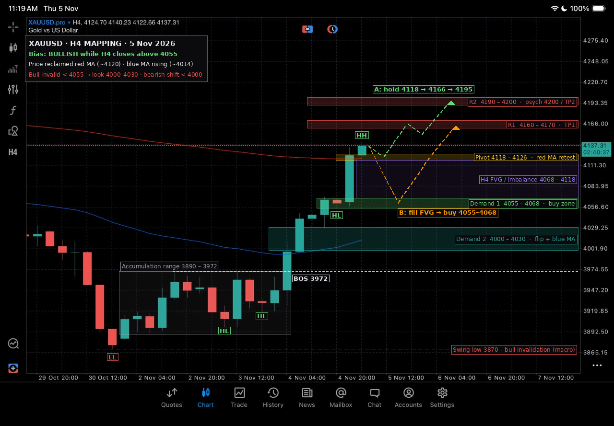

# XAUUSD H4 Mapping — 5 Nov 2026



Snapshot: H4 candle O 4124.70 · H 4140.23 · L 4122.66 · C **4137.31** (11:19, 5 Nov).
Original screenshot: [`original.jpg`](original.jpg).

## Structure

| Item | Read |
|---|---|
| Trend (H4) | **Bullish.** LL at 3870 (30 Oct), then accumulation 3890–3972, break of structure above 3972 on 4 Nov, and a run of higher lows and higher highs since |
| Red MA (slow) | ~4120, flattening. Price just closed back **above** it |
| Blue MA (fast) | ~4014 and rising. Price has been above it since the 4 Nov breakout |
| Momentum | Strong impulse on the 4 Nov 20:00 candle (4062 → 4125), which leaves an **unfilled H4 FVG** below |

## Key levels

| Zone | Price | Role |
|---|---|---|
| R2 | **4190 – 4200** | Round-number resistance, TP2 |
| R1 | **4160 – 4170** | First resistance, TP1 |
| Pivot | **4118 – 4126** | Retest of the red MA. Holding here keeps momentum |
| FVG | 4068 – 4118 | Imbalance from the impulse candle. A fill is likely |
| Demand 1 | **4055 – 4068** | Base the impulse launched from. Main buy-the-dip zone |
| Demand 2 | **4000 – 4030** | Old supply flipped to support, blue MA and the round number 4000 |
| BOS | 3972 | Top of the old range |
| Swing low | 3870 | Macro invalidation |

## Scenarios

**A. Continuation (green path).** Price holds the 4118–4126 pivot on a shallow dip, then runs to 4160–4170 (TP1) and 4190–4200 (TP2).
- Trigger: bullish H4 rejection or close above the pivot
- SL: below 4110

**B. Pullback first (orange path).** Price fills the FVG down into Demand 1 (4055–4068), then continues higher to 4166.
- Trigger: bullish reaction in 4055–4068, such as a pin bar or engulfing candle on M15–H1
- SL: below 4048
- Gives the best risk-to-reward

**C. Invalidation.** An H4 close below 4055 voids the immediate bullish setup.
- Next support: Demand 2 at 4000–4030, where buyers should defend
- An H4 close below 4000 shifts the bias to neutral or bearish, targeting a move back to the 3972 BOS level and the old range

## Notes

- **Avoid chasing longs at 4137.** Price sits right under R1, and the FVG below is still open. Waiting for a pullback into A's pivot or B's demand zone gives a better entry.
- **Watch news days.** On high-impact USD news, expect wicks through the zones. Trade off H4 closes, not wicks.
- **Levels are approximate.** They were read off the screenshot's price scale, so allow a few dollars either way.

> Educational chart mapping only, not financial advice. Manage your own risk.

## Regenerate the chart

```bash
python3 scripts/map_2026-11-05.py
```
