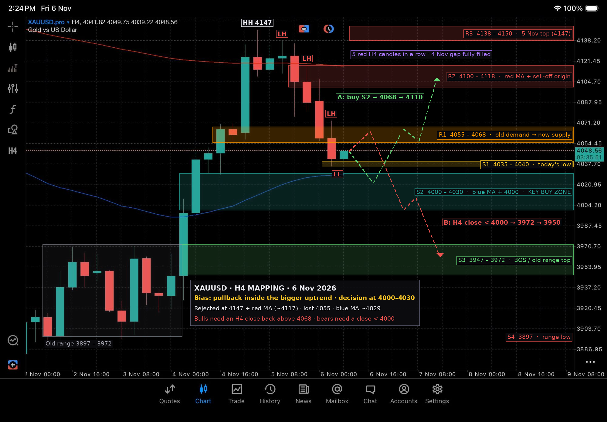

# XAUUSD H4 Mapping — 6 Nov 2026



Snapshot: H4 candle O 4041.82 · H 4049.75 · L 4039.22 · C **4048.56** (14:24, 6 Nov).
Original screenshot: [`original.jpg`](original.jpg).

## What changed since 5 Nov

Yesterday's continuation did not happen.
- Price topped at **4147**, just under R1 (4160–4170), and failed against the red MA.
- Five H4 candles in a row then closed red, filling the whole 4 Nov 20:00 impulse candle.
- Price closed below **4055**, which [yesterday's mapping](../2026-11-05/README.md) set as the line where the bullish setup fails.
- That mapping's next target was **Demand 2 (4000–4030)**. Price is now just above it.

## Structure

| Item | Read |
|---|---|
| Bigger picture (H4) | Still a higher low above 3870 and above the 3972 BOS. The move from 3870 to 4147 is intact for now |
| Short term | **Bearish pullback.** Lower highs at 4138, 4118, 4106 and 4073, and a low at 4035.6 |
| Red MA (slow) | ~4117. Price was rejected there and is back below it |
| Blue MA (fast) | ~4029, still rising but flattening. It sits inside S2 |
| Current candle | Small green candle off 4039, the first bounce attempt so far |

## Key levels

| Zone | Price | Role |
|---|---|---|
| R3 | 4138 – 4150 | 5 Nov top (4147). Bulls need to break it to restart the trend |
| R2 | **4100 – 4118** | Red MA, where the sell-off started |
| R1 | **4055 – 4068** | Yesterday's Demand 1, broken and now resistance (supply) |
| S1 | 4035 – 4040 | Today's low |
| S2 | **4000 – 4030** | Blue MA, the 4 Nov breakout base and 4000. **This is the key zone** |
| S3 | 3947 – 3972 | BOS level and top of the old range |
| S4 | 3897 | Range low |

## Scenarios

**A. Bounce from S2 (green path).** Price dips into 4000–4030, holds the blue MA, takes back 4068, then heads to 4100–4118.
- Buy trigger: a bullish H4 or H1 rejection inside 4000–4030
- SL: below 3995
- TP1: 4065. TP2: 4110
- Extra confirmation: an H4 close back above 4068

**B. Breakdown (red path).** Price is rejected again at R1 (4055–4068), then closes an H4 candle below 4000.
- Targets: 3972, then 3950 (S3)
- Sell idea: a rejection candle in 4055–4068, SL above 4075, TP 4030 / 4000
- Treat this as a counter-trend scalp until 4000 actually breaks

## Notes

- **Don't trade the middle.** 4040–4050 sits between R1 and S2, so let price reach one of them.
- **Sellers have short-term control** until an H4 candle closes above 4068.
- **The uptrend is still intact while 4000 holds.**
- **Friday caveat.** It's Friday, so expect thinner liquidity and possible weekend-gap risk. Size down or close positions before the weekly close.
- **Levels are approximate.** They were read off the screenshot's price scale, so allow a few dollars either way.

> Educational chart mapping only, not financial advice. Manage your own risk.

## Regenerate the chart

```bash
python3 scripts/map_2026-11-06.py
```
