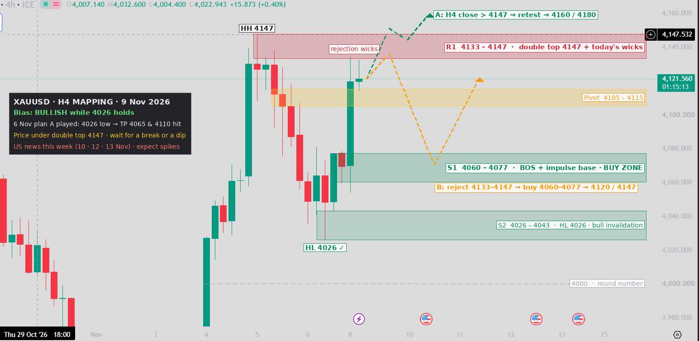

# XAUUSD H4 Mapping — 9 Nov 2026



Snapshot: TradingView 4h (ICE feed), price **4121.56**, current candle with 1h15m to close.
Original screenshot: [`original.png`](original.png).

> This chart uses a different feed from the 5–6 Nov MT5 charts, so levels can differ by a few dollars.

## What happened since 6 Nov

[6 Nov's Plan A](../2026-11-06/README.md) played out:
- Price dipped to **4026**, inside the 4000–4030 buy zone.
- It made a higher low and bounced.
- It hit TP1 at 4065 and TP2 at 4110.
- The 8 Nov candle broke the 4077 lower high, a bullish break of structure (BOS).

## Structure

| Item | Read |
|---|---|
| Trend | **Bullish.** Higher low at 4026 (above 4014) and a BOS above 4077 |
| Directly above | **Double top at 4147.** Both of today's candles left upper wicks (4134, 4132), so sellers are defending 4133–4147 |
| Momentum | Strong 8 Nov impulse from 4069 to 4119. The current candle is small |

## Key levels

| Zone | Price | Role |
|---|---|---|
| Targets | 4160 → 4180 | Only after a breakout |
| R1 | **4133 – 4147** | Double top and today's rejection wicks |
| Pivot | 4105 – 4115 | Base of the current candle and top of the 5 Nov sell-off |
| S1 | **4060 – 4077** | BOS level and impulse base. **Main buy zone** |
| S2 | 4026 – 4043 | Higher low at 4026. Bull invalidation |
| — | 4000 | Round number |

## Scenarios

**A. Breakout (green path).** An H4 candle closes above 4147, then price retests 4147 from above.
- Buy on the retest
- SL: below 4130
- TP: 4160 → 4180

**B. Pullback first (orange path).** Price is rejected again at 4133–4147 and falls to 4060–4077.
- Buy on a bullish rejection candle in 4060–4077
- SL: below 4055
- TP: 4120 → 4147

**Sell scalp (counter-trend, optional).** Sell an H4 rejection at 4133–4147.
- SL: above 4152
- TP: 4110 / 4080
- Keep it small, because the trend is up

**Invalidation.** An H4 close below 4026 breaks the higher low.
- Next levels: 4000, then 3975

## Notes

- **Avoid buying at 4121–4133.** Price is right under the double top, so wait for a breakout or a dip.
- **US news this week.** The calendar shows US events on 10, 12 and 13 Nov, so expect spikes through the zones. Trade off H4 closes.

> Educational chart mapping only, not financial advice. Manage your own risk.

## Regenerate the chart

```bash
python3 scripts/map_2026-11-09.py
```
