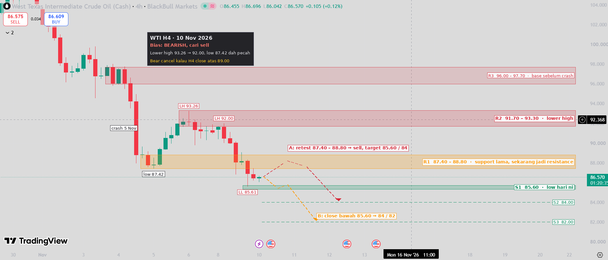

# WTI H4 Mapping — 10 Nov 2026

TradingView 4h (BlackBull). Price **86.57**.

**Bias: bearish.**
- Big crash on 5 Nov (94.2 → 88.8).
- The bounce made a lower high at 93.26, then another at 92.00.
- The 87.42 low has broken, and the new low is 85.61.

| Zone | Price |
|---|---|
| R3 | 96.00 – 97.70 |
| R2 | 91.70 – 93.30 (lower high) |
| R1 | **87.40 – 88.80** (old support, now resistance) |
| S1 | 85.60 |
| S2 / S3 | 84.00 / 82.00 |

- **A:** price pulls back to 87.40–88.80. Sell on rejection, SL above 89.20, TP 85.60 / 84.00.
- **B:** an H4 close below 85.60 targets 84 / 82.
- An H4 close above 89.00 cancels the bearish setup.

> Educational chart mapping only, not financial advice.
