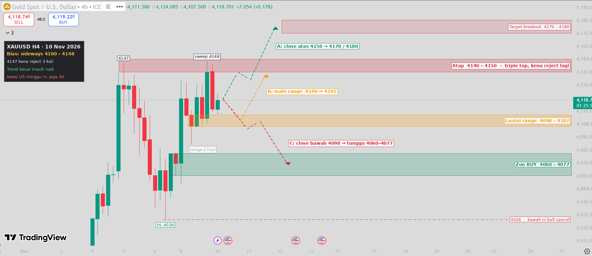

# XAUUSD H4 Mapping — 10 Nov 2026

TradingView 4h (ICE). Price **4118.70**.

**Recap 9 Nov:** price swept 4147 up to 4148, then got rejected again (red H4 back to 4111). The H4 candle closed at 4140, so the breakout never confirmed. There have now been 3 rejections around 4147.

**Bias:** sideways 4100–4148. The bigger trend is still up while price stays above 4026.

| Zone | Price |
|---|---|
| Breakout target | 4170 – 4180 |
| Top (resistance) | **4140 – 4150** |
| Range floor | **4098 – 4107** |
| Buy zone | 4060 – 4077 |
| Bull invalidation | 4026 |

- **A:** an H4 close above 4150 targets 4170 / 4180.
- **B:** play the range. Buy at 4098–4107, sell at 4140–4148.
- **C:** an H4 close below 4098 means waiting for a buy at 4060–4077.

> Educational chart mapping only, not financial advice.
