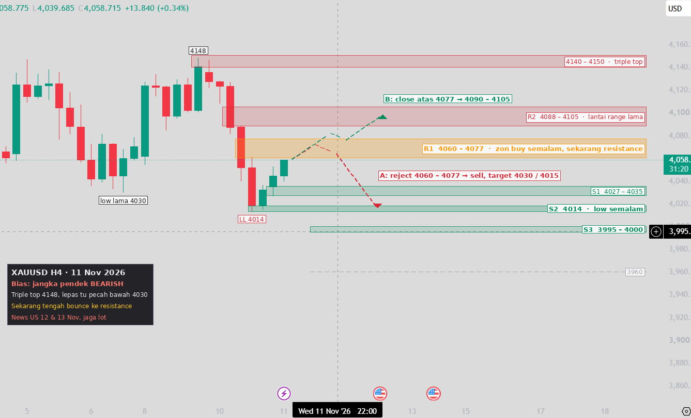

# XAUUSD H4 Mapping — 11 Nov 2026

TradingView 4h. Price **4058.7**.

**Recap 10 Nov:** price broke the range floor (scenario C), then cut straight through the 4060–4077 buy zone. It made a new low at 4014, and an H4 candle closed below 4026, so the bullish setup is **cancelled**. Triple top at 4148, then a lower low below 4030: short-term structure is now bearish.

**Now:** a 3-candle bounce from 4014, sitting just under 4060–4077.

| Zone | Price |
|---|---|
| Triple top | 4140 – 4150 |
| R2 | 4088 – 4105 (old range floor) |
| R1 | **4060 – 4077** (yesterday's buy zone, now resistance) |
| S1 | 4027 – 4035 |
| S2 | **4014** (yesterday's low) |
| S3 | 3995 – 4000 |
| — | 3960 |

- **A:** price is rejected at 4060–4077. Sell, SL above 4082, TP 4030 / 4015.
- **B:** an H4 close above 4077 cancels the sell and targets 4090–4105.
- **Below 4014:** price heads to 3995–4000, then 3960.

US news on 12 and 13 Nov.

> Educational chart mapping only, not financial advice.
